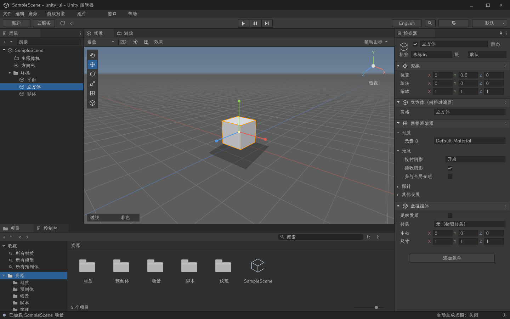

# ASMUI · Unity 编辑器界面

用 x86-64 ASM 渲染 Unity 编辑器风格的桌面界面。当前 v0.21 的目标是深色编辑器：层级、场景 / 游戏、检查器、项目 / 控制台、工具栏与菜单。默认简体中文，使用本机的 **LXGW WenKai / 霞鹜文楷**，可即时切换 English。



```sh
make editor                         # 启动可交互的 SDL3 + Vulkan 窗口
make editor-demo                    # 相同渲染路径，输出 build/editor.png
./build/editor --lang en-US          # 英文界面
```

顶部 `English / 简体中文` 按钮切换语言。也可通过环境变量指定：

```sh
ASMUI_LANG=zh-CN ASMUI_FONT="$HOME/.local/share/fonts/LXGWWenKai-Regular.ttf" make editor
```

点击层级中的对象可切换检查器；立方体的位置、三轴旋转和缩放可编辑。拖动分隔线调整面板，滚轮滚动检查器与项目列表。场景内右键拖动环绕、滚轮缩放，`F` 重置视角，`Q/W/E/R/T/Y` 切换工具外观，`2D` 切换正交视图。播放、暂停、单步和场景 / 游戏标签有状态反馈。`F12` 保存当前画面。

这是编辑器视觉与交互原型；层级和检查器目前使用内置示例，尚未接入通用 Unity 项目读写或构建。Game 视图可加载下述 Rust 应用；运行不依赖 C#。未接入的菜单项置灰。场景示例使用投影网格和立方体，其他对象用于展示检查器样式。

## DiffSinger-ASM 虚拟歌姬编辑器

`application/DiffSinger-ASM` 是基于当前框架的 DiffSinger 专属虚拟歌姬编辑器。汇编编辑核心与 UI 围绕声库、歌词/音素、音高控制和歌声预览发展，唯一歌声引擎为本机 DiffSinger-ASM。`application/diffsinger` 已软链接到 `/home/fuurin/asm/diffsinger`，方便直接修改原源码。

```sh
make diffsinger                     # 钢琴卷帘、中文歌词、音高/参数、真实歌声合成与播放
make diffsinger-check               # 汇编编辑、TLP 读写与交互回归
make diffsinger-window-check        # 真实 SDL/Vulkan 窗口与音频消费时钟
make diffsinger-render-check        # 本机现有声库的原生合成与 WAV 验收
make diffsinger-ustx-check          # 现有 OpenUtau USTX 工程的导入和重开
```

此版本支持直接导入 OpenUtau `.ustx`、另存 `.dse`、兼容 `.tlp`、轨道/片段、撤销重做、中文输入、后台合成、缓存播放与 WAV 导出。WAV/FLAC 伴奏支持波形、移动/裁剪/淡入淡出、音量/声像、独立试听和与歌声混音；USTX 原始数据随新工程保留，源文件保持只读。当前使用确定性音素时长分配；variance / duration 预测、渐进播放和变速尚未实现。详细边界与声库配置见 [DiffSinger-ASM 说明](application/DiffSinger-ASM/README.md)，完整产品剩余工作见 [开发清单](application/DiffSinger-ASM/docs/DEVELOPMENT.md)。新增的桌面宿主与有界画布随编辑器需求持续改进。

## OpenSekai 的 Rust 应用迁移

`application/OpenSekai_Community_rs` 正在迁移为 Rust 应用，通过版本化 C ABI 接入 Game 视图；渲染仍走现有 ASM 节点、字形、批处理与 Vulkan 后端。编辑器保持默认中文与 LXGW，应用保留原项目字体文件。

```sh
make opensekai-editor               # 构建 Rust 动态库并在编辑器中运行
make opensekai-check                # 原源码哈希、C# 对照、Rust 数据与实际 C ABI 测试
make opensekai-assets               # 从原项目生成资产 / GUID / 组件索引
make opensekai-window-check         # 真实窗口中文输入、谱面编辑/撤销/保存与缩放
make opensekai-live-check           # 真实窗口按键演奏、暂停、结算与音频时钟
```

用户放入的官谱已归档到 `application/OpenSekai_Community_rs/content/official/source`，3,507 张谱面转换为 `content/library` 中的可编辑包，默认启动即加载。管理页支持按曲名、ID、难度搜索。选择谱面后点击「无音乐练习」即可用键盘演奏：12 个轨道键为 `A S D F G H J K L ; ' /`，按住连接长条、松手判定尾部，空格或方向键划动，`Esc` 暂停，暂停/结算页可重试、返回。

Tell Your World 六个难度已补入原版音乐与封面；[原版美术及全部音效](application/OpenSekai_Community_rs/resources/opensekai/README.md) 另有 Git 追踪的资源快照和哈希清单。判定、摩擦/划动、长条循环和手动结算已使用原版音效，独立混音不改变音乐时钟。其他缺少音乐的谱面继续标明练习模式。音频栏可补入 OGG/MP3/WAV，运行时由 FFmpeg 解码、SDL 播放，并按音频时钟推进判定。完整设置、原版演出/特效/MV、历史记录与应用项目树/检查器仍在迁移中；当前截图不能证明整款应用视觉完全一致。基准、运行方式和验收范围见 [OpenSekai 迁移说明](application/OpenSekai_Community_rs/native/README.md)。

## 构建与验证

需要 Linux x86-64、C 编译器 / GNU assembler、`make`、`pkg-config`、SDL3、Vulkan 1.3 驱动与头文件、`glslc`、FreeType、HarfBuzz、libpng。视觉检查另需 Python 3 与 Pillow。字体不随源码打包。

```sh
make editor-check                   # ASM 投影/命中、输入、字形与多语言状态
make editor-visual-check            # 实际 Vulkan PNG 回读与布局检查
make editor-smoke                   # 真实窗口、缩放、SDL 中文输入事件
make verify                         # 编辑器与既有渲染核心回归
```

无桌面时可以执行 `editor-demo` 和 `editor-visual-check`，仍然需要可用的 Vulkan 驱动。

多语言设计、字体选择与扩展步骤见 [多语言 UI 方案](docs/LOCALIZATION.md)。视觉参照、验证范围及 ASM/C 边界见 [编辑器实现说明](docs/EDITOR_UI.md)；本轮证据见 [验证记录](artifacts/2026-09-25-editor/REPORT.md)。旧音游场景仍保留为渲染回归样例，运行 `make song-select-demo` 或 `make song-select-sdl-demo`，开发记录见 [历史版本](docs/HISTORY.md)。
