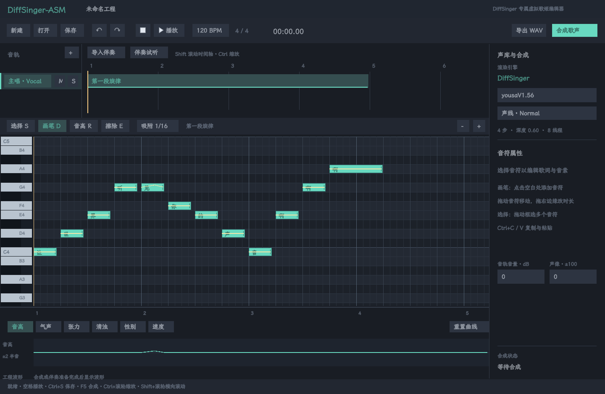
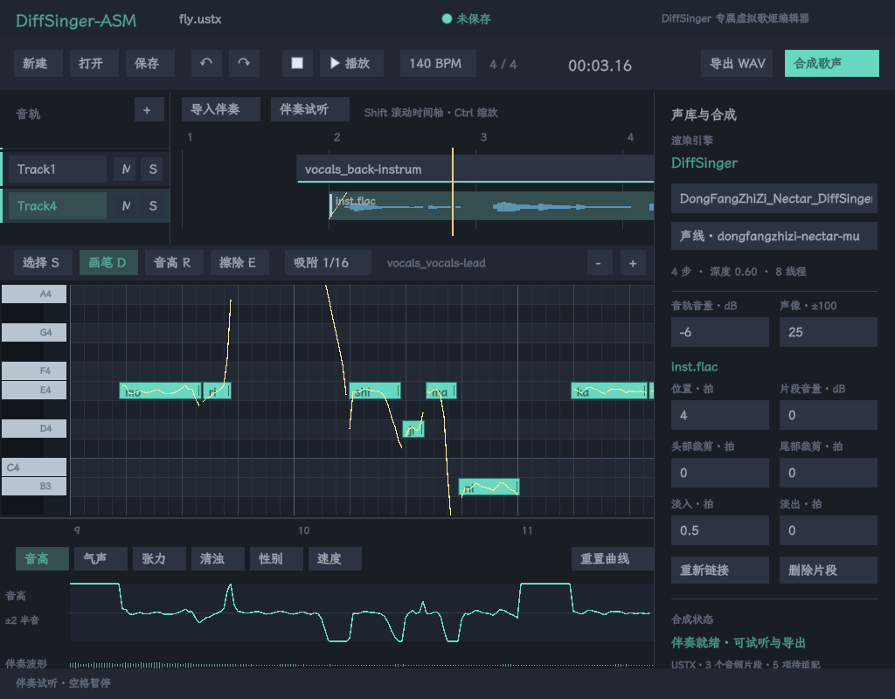

# DiffSinger-ASM

基于当前 ASMUI 的 Linux x86-64 DiffSinger 专属虚拟歌姬编辑器，唯一歌声引擎是本机 DiffSinger-ASM。产品围绕 DiffSinger 声库、歌词/音素、音高与表现参数、合成预览和导出构建；具体发展方向见 [产品定位](docs/PRODUCT.md)。

音符编辑、命中、曲线插值、F0 生成、立体声增益/淡入淡出混音与 UI 渲染核心使用汇编；SDL3、文件格式、字体、合成任务、音频解码与设备由 C 层接入。UI 框架随这些编辑需求持续改进。



从 UI 框架根目录运行：

```sh
make diffsinger-build
make diffsinger                          # 打开内置中文旋律，可直接编辑、合成
make diffsinger DIFFSINGER_ARGS='--new'   # 空白工程
make diffsinger DIFFSINGER_ARGS='--project application/DiffSinger-ASM/examples/first-song.tlp'
```

也可以在本目录运行 `make`、`make run`、`make run ARGS='--new'`。程序位于 `build/diffsinger-asm`；构建时记录框架路径，启动时无需切换到框架目录。

## 打开现有 OpenUtau 工程

「打开」支持 `.ustx`、本编辑器的 `.dse` 和兼容 `.tlp`。可以直接打开 Music 中的工程：

```sh
make diffsinger DIFFSINGER_ARGS='--project /home/fuurin/Music/萤琢/fly.ustx'
```

USTX 导入支持 0.7 / 0.8 / 0.9、480 PPQ、恒定速度和单一拍号，保留歌声轨、片段、音符、歌词、轨道增益/声像/静音/独奏，并将音符弯音和 `pitd` 合为 5 tick 网格的可编辑音高曲线。导入曲线随音符移动和转调，撤销会一并恢复。首次打开会定位到第一段歌声的首个音符。

USTX 保持只读；「保存」会提示另存为 `.dse`。新工程同时保存当前编辑数据和完整原始 USTX 文本，包括伴奏引用、声库信息和未适配字段，重开时继续保留。原始文本是导入时的快照；当前不提供修改后的 USTX 回写。

USTX 音频片段现已进入时间轴、伴奏试听和完整工程混音。日文读音、音素提示、普通 `+` 的音节推进与 `+~` / `+*` 延音已接入当前前端。USTX 表情曲线、逐音素覆盖、声线混合、颤音和完整 OpenUtau 音素器尚未接入；界面显示未应用数量。导入成功不代表原曲全部合成语义已适配。可用的同名已打包 DiffSinger 声库会自动匹配其语言和词典，其他工程需选择已适配声库。详细边界及验收见 [USTX 导入说明](docs/USTX_IMPORT.md)。

## 伴奏与混音



打开包含伴奏的工程会在后台准备音频和波形，完成后可直接试听。「导入伴奏」或把音频文件拖入窗口会创建音频片段；WAV / FLAC 已用本机歌曲验收。支持单声道和立体声，8–384 kHz，统一以高质量 sinc 重采样到 44100 Hz。文件读取使用 libsndfile，不启动 Python 或 FFmpeg 在线进程。

点击音频片段后，可拖动移动、拖两端裁剪，在右侧设置位置、头尾裁剪、淡入淡出、片段音量，以及音轨音量和声像。位置和裁剪显示为拍数，内部使用 480 PPQ tick，沿用 OpenUtau 的含义。删除、移动、裁剪和混音参数进入同一撤销历史。缺失文件可用「重新链接」恢复。

「伴奏试听」独立准备音频，不要求歌声模型可用。「合成歌声」合成可听歌声轨，再与可听音频轨混音；两种结果在界面中分别标识。静音、独奏、音量和声像对两者均生效。「导出 WAV」导出当前已准备的结果，伴奏预览导出伴奏，完整合成导出歌声与伴奏混音。

编曲区滚轮切换可见轨道，`Shift` + 滚轮滚动时间轴，`Ctrl` + 滚轮缩放，点击上方刻度定位播放头。媒体引用以绝对路径保存，另存工程不会改变其解析基准；跨机器迁移需要重新链接。保存/导出会拒绝覆盖本工程引用的原音频，包括同一文件的硬链接。

```sh
./application/DiffSinger-ASM/build/diffsinger-asm --new --import-audio backing.flac
./application/DiffSinger-ASM/build/diffsinger-asm \
  --project /home/fuurin/Music/萤琢/fly.ustx --render-audio /tmp/backing.wav
```

## 编辑与合成

钢琴卷帘支持添加音符、拖动移动、右边缘改变时长、框选、多选、删除、复制粘贴、32 步撤销/重做、缩放及滚动。歌词与音素栏支持 UTF-8 中文输入和 IME 预编辑；多选时修改会应用到全部选中音符。音高画笔和下方五条参数曲线参与真实合成。

| 操作 | 键盘 / 鼠标 |
| --- | --- |
| 选择 / 音符画笔 / 音高画笔 / 擦除 | `S` / `D` / `R` / `E` |
| 框选 / 切换多选 | 选择工具拖动空白处 / `Shift` 点击 |
| 改歌词 | 双击音符、`Enter`，或右侧歌词栏 |
| 移动 / 转调 | 方向键；`Ctrl` + 上下为八度 |
| 改时长 | 拖动右边缘，或 `Shift` + 左右 |
| 复制 / 粘贴 | `Ctrl+C` / `Ctrl+V`，粘贴到播放头位置 |
| 撤销 / 重做 / 保存 | `Ctrl+Z` / `Ctrl+Y` / `Ctrl+S` |
| 合成 / 播放暂停 / 回到开头 | `F5` / `Space` / `Home` |
| 滚动音高 / 时间 / 缩放 | 滚轮 / `Shift` + 滚轮 / `Ctrl` + 滚轮 |
| 截图 | `F12` |

音轨旁的 `+` 创建歌声轨；编曲区双击空白处创建片段，点击片段切换编辑内容。`M` / `S` 分别静音 / 独奏。BPM 栏可修改恒定速度。新建、打开及退出时会提示处理未保存的修改。

点击「合成歌声」执行后台合成；再次点击可取消。合成完成后，播放、波形与 WAV 导出使用同一份真实 PCM。播放头按 SDL 音频流实际消耗的数据推进。编辑音符、曲线、速度或声线会使旧缓存失效；合成期间仍可编辑，但过期结果不会替换当前版本。

播放使用当前版本的预览缓存。没有缓存时，含音频片段的工程先准备伴奏，其余工程先合成歌声。需要完整歌声与伴奏预览时点击「合成歌声」。此版本尚未在首次合成中渐进播放。

## 歌词与音素时长


声库的「歌词语言」决定自动读音词典。中文支持汉字/拼音，日文支持假名、罗马字和 MeCab 汉字读音，英文查实际声库词典。选中音符后，卷帘下方显示与合成相同的实际音素。右侧「音素 / 读音」可覆盖自动读音。

单选音符，在「音素时长 ms」中按当前音节的音素顺序填写毫秒，例如 `ja/k ja/a` 填 `80 *`，用一个 `*` 填满余下时长。多音节词的各个普通 `+` 音符可独立调整；点击 `+~` / `+*` 的时长栏会转到所属音节。「重置」恢复该音节的自动分配。时长参与撤销、重做、整组独立复制粘贴及保存重开；修改歌词会重新生成音素并恢复词组各音节的自动时长。右侧面板可滚动。

合成会先检查全部可听片段。也可仅运行歌词预检，不启动模型推理：

```sh
./application/DiffSinger-ASM/build/diffsinger-asm \
  --project /home/fuurin/Music/白い雪/snow.ustx --check-lyrics
```

日文短句、手工时长和英文连音均已通过真实原生引擎；完整歌曲的发音、对齐和听感仍需验收。具体规则、限制及源歌曲诊断见 [前端说明](docs/FRONTEND.md)。

## DiffSinger 源码与声库

```text
application/diffsinger -> /home/fuurin/asm/diffsinger
```

这是源码软链接，编辑链接内的文件会直接修改原项目；没有复制源码或建立第二套引擎。引擎现有二进制入口为：

```text
application/diffsinger/build/dsasm-acoustic
application/diffsinger/build/dsasm-vocoder-m40
```

引擎修改后可运行 `make diffsinger-engine` 重新构建这两个入口，该命令会写入链接目标的构建目录。独立构建或修改引擎前遵循其 [AGENTS.md](../diffsinger/AGENTS.md) 与运行时实现政策。

本机默认声库为 `/home/fuurin/.local/share/OpenUtau/Singers/yousaV1.56` 中已经存在的原生模型数据。编辑器会解析其中 `dsasm/current.json` 到打包目录，并直接调用当前引擎 CLI；无需运行 OpenUtau，也不恢复其旧 ABI 或协议。

点击右侧声库栏可以选择另一套已打包目录。点击声线栏会循环目录中实际存在的 `.emb` 文件。此版本每个工程共用一套声库与声线。可以显式指定：

```sh
DIFFSINGER_EDITOR_SINGER=/path/to/packed-singer \
DIFFSINGER_EDITOR_DICTIONARY=/path/to/dsdict.yaml make diffsinger

./application/DiffSinger-ASM/build/diffsinger-asm \
  --singer /path/to/packed-singer --language ja --dictionary /path/to/dsdict.yaml \
  --speaker Normal --steps 4 --workers 8
```

打包目录需包含 `acoustic/fs2_acoustic.dsfs`、`aux_convnext.dsa`、`lynxnet2.dsn`、`model.conf`、`phonemes.json`，以及 `vocoder/384.dsv35` 和 `384.json`。需要外部说话人条件的模型还必须提供所选声线的 `acoustic/<name>.emb`。当前适配契约为 44100 Hz、hop 512、128 mel、384 帧声码器。

默认参数为 4 步、深度 0.6、8 个工作线程、固定 seed 42。参数和声库配置随 `.dse` / `.tlp` 的 `asmui` 字段保存；命令行参数可覆盖它们。不会自动下载模型。

合成使用声库实际的音素和语言元数据，逐音素语言写入原生 CLI 的 `--languages` 输入。自动时长按元音类型进行确定性分配，也可使用本编辑器的手工时长。F0 使用音符音高和手绘曲线。神经网络 duration / variance / pitch 与学习对齐尚未接入；未知音素、过短音符和同片段重叠会报告具体位置。

无窗口直接导出真实歌声：

```sh
./application/DiffSinger-ASM/build/diffsinger-asm \
  --project application/DiffSinger-ASM/examples/first-song.tlp --render /tmp/first-song.wav
```

输出为 44100 Hz / stereo / PCM16 WAV。失败或取消时保留已有输出文件。每个任务的张量与 `engine.log` 留在程序打印的 `/tmp/diffsinger-render-*` 目录，便于排查。

## 工程格式与当前边界

工程交换兼容 TuneLab `.tlp` JSON v0/v1 的音符/连续曲线子集：480 PPQ、恒定速度、单一拍号、歌声 MIDI 片段，音轨 gain/pan/mute/solo，以及 pitch、breathiness、tension、voicing、gender、velocity。颜色为 `#RRGGBB`。新保存的工程标识为 `DiffSinger-ASM`。打开失败不会替换当前工程；保存采用同目录临时文件与原子重命名。

容量为 8 条音轨、32 个歌声片段、64 个音频片段、2048 个音符、262144 个曲线点。歌词、音素与歌声名称最多 63 个 UTF-8 字节；音频名称最多 255 字节。单歌声片段最长 10 分钟，单音频文件及整工程输出最长 30 分钟。

当前不支持变速工程、其他渲染引擎、逐片段声库、TLP 自身的固定音素结构、颤音对象、效果器、歌声片段裁剪、自定义音符属性、分段 pitch，以及 TLP CBOR。本编辑器的 `phonemeTiming` 与音频片段是原生扩展，不能视为完整 TLP 对应格式兼容。USTX 中未适配数据按上文规则保留原文并提示。`.mid` 文件导入、歌声片段移动/重命名和完整声库参数面板尚未实现。撤销历史覆盖乐谱和音频编辑，声库配置单独保存。完整产品的剩余工作见 [开发清单](docs/DEVELOPMENT.md)。

这是可运行的首个编辑与合成版本。后续验收围绕 DiffSinger 的模型契约、发音、音素时长、音高与实际歌曲听感展开。张量、PCM、交互测试通过只验证其覆盖的行为，歌声自然度与听感仍需独立评估。

## 依赖与验证

在框架既有 Linux x86-64、GNU assembler / C11、SDL3、Vulkan 1.3、glslc、FreeType、HarfBuzz、libpng 依赖上，增加 `json-c`、`libyaml`、ICU、libsndfile、libsamplerate 和 MeCab。Arch 官方包为 `json-c libyaml icu libsndfile libsamplerate`，MeCab / UTF-8 IPA 词典可通过 `paru -S mecab mecab-ipadic` 安装。日文汉字读取 `/usr/lib/mecab/dic/ipadic`。在线运行使用 C / ASM 与原生系统库；Python / Pillow / PyYAML 用于验收。

```sh
make diffsinger-check                   # 汇编、文件格式、交互、密集场景、历史与保存
make diffsinger-sanitize                # ASan / UBSan / LeakSanitizer
make diffsinger-window-check            # 真实 SDL/Vulkan 窗口、中文输入、保存、合成、播放
make diffsinger-render-check            # 现有真实声库与原生 CLI，不使用假渲染器
make diffsinger-frontend-check          # 日文/英文、多语言编号、连音、时长张量与真实 PCM
make diffsinger-frontend-window-check   # 音素显示、时长、IME、复制、撤销、保存及窗口合成
make diffsinger-visual-check            # GPU 绘制 2048 音符与输入字形缓存轮换
make diffsinger-demo                    # GPU 回读 build/editor.png
make diffsinger-ustx-check              # Music 中 USTX 的导入、原数据保留和重开
make diffsinger-ustx-window-check       # 真实 USTX 歌曲的 SDL/Vulkan 编辑与输入
make diffsinger-audio-check             # 16 个真实音频引用、原生歌声混音及原文件保护
make diffsinger-audio-window-check      # 真实工程的伴奏波形、播放、裁剪/混音参数与保存
```

`window-check` 需要真实 X11 显示和可呈现的 Vulkan 设备；它使用 SDL dummy 音频设备检查消费时钟。`demo` / `visual-check` 无需窗口，但仍使用 Vulkan GPU。渲染验收需要本机现有声库和引擎二进制。

代码边界见 [ARCHITECTURE.md](docs/ARCHITECTURE.md)，验证范围见 [VALIDATION.md](docs/VALIDATION.md)，格式参考与第三方归属见 [THIRD_PARTY.md](docs/THIRD_PARTY.md)。
